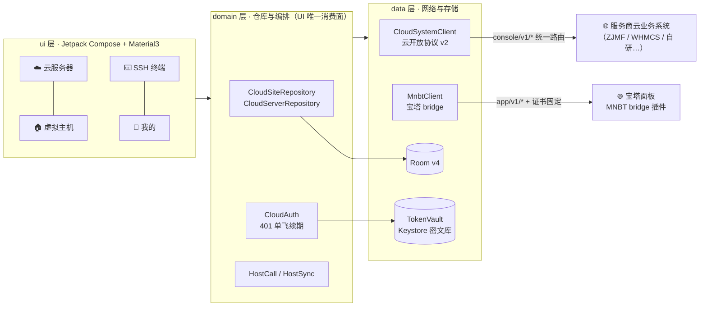

<div align="center">

# ☁️ 智能云管

**云服务器 · 虚拟主机 · SSH 终端，一端掌控**

[](releases)
[](https://developer.android.com)
[](https://kotlinlang.org)
[](https://developer.android.com/jetpack/compose)
[](docs/cloud-integration.md)

一款系统无关的云资产管家 Android 客户端 —— 扫码绑定站点，管理云服务器、虚拟主机与 SSH 终端。

[功能特性](#-功能特性) · [开放对接](#-开放对接任何云系统都能接) · [架构设计](#-架构与技术栈) · [快速开始](#-快速开始) · [参与贡献](#-参与贡献)

</div>

---

## 📖 项目简介

**智能云管（MNBT APP）** 是一款原生 Android 应用，面向拥有多台云服务器 / 虚拟主机的站长与运维人员。
通过**扫码配对**把站点加入手机，即可随时查看服务器运行状态、下发电源指令、获取 VNC 控制台、
管理宝塔虚拟主机，并内嵌完整 SSH 终端。

项目的核心设计是 **「MNBT 云开放协议 v2」**：App 只实现一套系统无关的标准协议，
任何云业务系统（智简魔方、WHMCS、魔方云、自研面板……）的服务商按规范实现一组 HTTP 端点
即可被 App 直接纳管，**无需 App 改代码发版**。

> 💡 服务商接入文档：[docs/cloud-integration.md](docs/cloud-integration.md)

<!-- TODO: 应用截图，建议 3~4 张竖屏 PNG 放 docs/screenshots/ 后取消注释
<p align="center">   </p>
-->

## ✨ 功能特性

<table>
<tr><td width="50%" valign="top">

### ☁️ 云服务器管理

- 📷 **扫码绑定站点** —— 一次配对，设备令牌 30 天滑动续期
- 🗂 **多站点分组列表** —— 电源状态胶囊、到期日 ≤7 天红色高亮
- ⚡ **电源操作** —— 开机 / 关机 / 重启 / 强制关机 / 强制重启，下发后自动轮询状态
- 🖥 **VNC 控制台** —— 一键拉起浏览器，相对地址自动归一化
- 📊 **流量用量** —— 自绘细进度条，≥80% 橙色、≥95% 红色预警
- 🔑 **登录凭据** —— 密码打码展示、一键复制
- 🧩 **能力协商** —— 服务端未声明的功能自动隐藏，界面永远真实

</td><td width="50%" valign="top">

### 🏠 虚拟主机管理（宝塔）

- 📁 **文件管理** —— 增删改压解、GBK 字节无损传输、多选批量
- 🗄 **数据库管理** —— 列表、备份下载/恢复、SQL 导入
- 🌐 **域名 / SSL** —— 绑定域名管理、证书信息与强制 HTTPS
- ⚙️ **站点配置** —— PHP 版本、运行目录、伪静态、默认文档、缓存规则、防盗链
- 📈 **监控告警 / 公告 / 一键部署**
- 🔒 **TLS 证书指纹固定** —— 自签证书可选信任并 pin 叶子指纹

</td></tr>
<tr><td width="50%" valign="top">

### ⌨️ SSH 终端

- 独立会话管理，与配对主机互不相通
- Termux 同源渲染内核，颜色与字体观感在线
- 熄屏保持连接（WAKE_LOCK）

</td><td width="50%" valign="top">

### 🛡️ 安全设计

- 🔐 **TokenVault 密文库** —— Keystore 主密钥 + AES256-GCM，Keystore 失效自动重建并引导重绑
- 🚫 **密文不出库** —— Room 只存引用键（ref），令牌永不落明文数据库
- 🔁 **401 单飞恢复** —— 并发 401 仅一次 refresh，令牌轮换不互相踩踏
- ⏱ **防重放** —— 全部 POST 携带 `_r` 时间戳，服务端 3 秒窗口去重

</td></tr>
</table>

## 🔌 开放对接：任何云系统都能接

App 与云站点之间只讲 **MNBT 云开放协议 v2**（[完整规范 →](docs/cloud-integration.md)）。
服务商在自己系统上实现以下端点 + 一个配对二维码，即可获得与内置系统完全一致的体验：

```json
{"app":"mnbt","type":"你的系统标识","proto":2,"url":"https://你的站点根","code":"一次性配对码"}
```

| 方法 | 路径（前缀 `/console/v1/`） | 说明 |
|:---:|---|---|
| POST | `mnbt/bind` | 配对码换设备令牌（JWT，30 天滑动续期） |
| POST | `mnbt/refresh` / `mnbt/unbind` | 令牌续期 / 设备吊销 |
| GET | `mnbt/config` | 站点名、操作密码开关、**proto + capabilities** |
| GET | `mnbt/cloud/servers` · `mnbt/cloud/server/{id}` | 服务器列表 / 详情（详情兼作状态轮询源） |
| POST | `mnbt/cloud/server/{id}/power` | 电源指令（`func` + 可选操作密码） |
| GET/POST | `mnbt/cloud/server/{id}/flow` · `/{id}/vnc` | 归一化流量 / VNC 地址（能力可选） |

`capabilities` 声明 `hard_power` `vnc` `flow` `credentials` `config_text` 可选能力，
App 据此显隐界面 —— **做不到的功能不声明，用户就看不到**。

<details>
<summary>🧪 本地联调：零依赖 Mock Server</summary>

```bash
# 启动 mock（同文件实现 MNBT bridge 与云开放协议 v2 两套契约）
node tools/mock/server.mjs --port=8787

# 契约自测（70+ 断言，覆盖双协议）
node tools/mock/test.mjs
```

示例站点含 3 台服务器（on / off / operating × ISO8601 / 秒级时间戳），操作密码 `123456`，
`POST /__mock__/reset` 可随时重置运行时状态。
</details>

## 🏗️ 架构与技术栈



| 技术选型 | 说明 |
|---|---|
| **Kotlin 2.0** | 全量 Kotlin，JVM 17，无 Java 业务代码 |
| **Jetpack Compose + Material3** | 单 Activity + Navigation Compose，零 XML 布局 |
| **OkHttp 4 + kotlinx.serialization** | 手写协议客户端，无 Retrofit，双协议共享连接池 |
| **Room v4 + EncryptedSharedPreferences** | 结构化数据与密钥分库，schema 版本化导出 |
| **Apache SSHD / Termux 终端视图** | 内嵌 SSH，sora-editor 代码高亮 |
| **R8 full mode** | release 体积约 8MB，4096m 堆构建 |

## 🚀 快速开始

**环境要求**：Android Studio（AGP 8.8+）、JDK **17**（Gradle 8.10 不支持 JDK 25+，请将 `JAVA_HOME` 指向 JDK 17）、Node.js（仅 mock 联调用）

```bash
git clone https://github.com/yang1145/mnbt-app.git
cd mnbt-app

# Debug 构建
./gradlew :app:assembleDebug

# Release 构建（R8 full mode，产物 8MB 级）
./gradlew :app:assembleRelease

# 运行 JVM 单元测试
./gradlew :app:testDebugUnitTest

# mock 联调（可选）
node tools/mock/server.mjs --port=8787
```

安装 Debug 包后，用 mock 站点后台生成绑定二维码即可体验完整流程。

## 📂 项目结构

<details>
<summary>展开目录树</summary>

```
mnbt-app/
├─ app/src/main/java/com/mnbt/app/
│  ├─ AppContainer.kt            # 手工 DI 根（全 lazy，冷启动预算友好）
│  ├─ data/
│  │  ├─ local/db | secure       # Room（v4，schema 导出）+ TokenVault 密文库
│  │  └─ remote/
│  │     ├─ api/cloud            # ☁️ 云开放协议 v2 客户端与 DTO
│  │     ├─ api/…                # 🏠 宝塔 bridge 客户端（60+ action）
│  │     ├─ http/  trust/        # OkHttp 工厂、证书探测与指纹固定
│  ├─ domain/
│  │  ├─ model/  repo/  sync/  call/   # 领域模型、仓库、编排、通用调用门面
│  ├─ ssh/                       # Apache SSHD 会话管理
│  └─ ui/                        # Compose 界面（cloud/hosts/pair/ssh/mine…）
├─ docs/
│  ├─ cloud-integration.md       # 📄 云开放协议 v2 对接规范（服务商向）
│  └─ prd/  p5-handoff.md        # 产品文档
├─ tools/mock/                   # 零依赖 mock server + 契约自测
└─ terminal/                     # Termux 终端视图源码模块
```

</details>

## 🗺️ 路线图

- [x] 云开放协议 v2：统一服务器操作路由、能力协商、二维码版本门槛
- [x] 系统无关化：ZJMF 专属逻辑全部收归服务端，App 只认协议
- [x] mock server 双协议契约自测（70+ 断言）与 JVM 单测
- [ ] 服务商接入示范插件（PHP / ZJMF addon v2）
- [ ] 虚拟主机栈纳入统一 Provider 架构（二期）
- [ ] CI 构建 / 自动发布渠道

## 🤝 参与贡献

欢迎 Issue 与 PR！

1. Fork → 新建特性分支（`feat/xxx`）
2. 提交信息遵循仓库惯例：`type: 中文描述`（`feat` / `fix` / `refactor` / `docs` / `chore`）
3. 改动协议时请同步 [docs/cloud-integration.md](docs/cloud-integration.md) 与 `tools/mock/` 契约测试
4. 提交前确保 `./gradlew :app:testDebugUnitTest` 与 `node tools/mock/test.mjs` 全绿

## 📄 许可证

本项目暂未设置开源许可证，**默认保留所有权利**。如需二次分发或商用授权，请联系仓库所有者。

<div align="center">

**如果这个项目对你有帮助，欢迎点一个 ⭐ Star**

</div>
